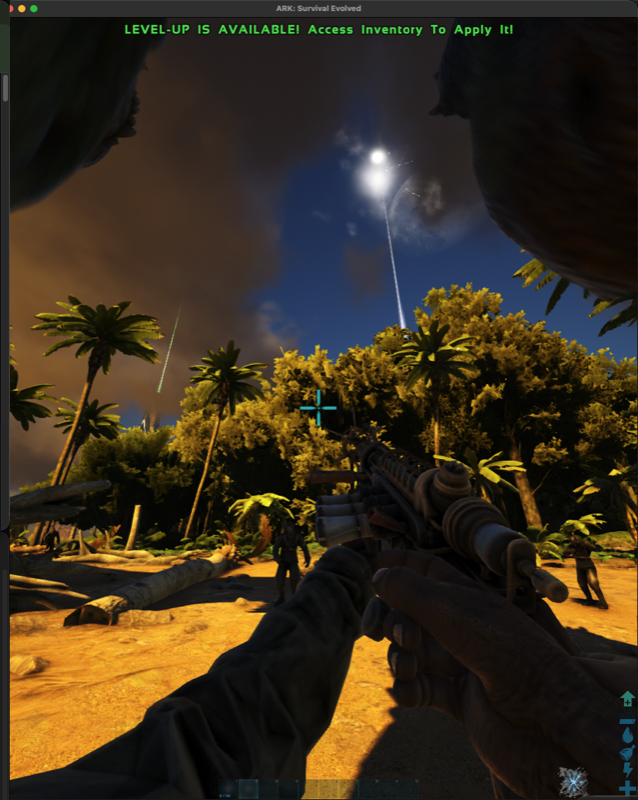

# ARK × World at War Zombies: Wonder Weapons mod

An offline, single-player mod for **ARK: Survival Evolved** (the original UE4 ARK, not Ascended).
It brings the **Ray Gun** and **Wunderwaffe DG-2** from *Call of Duty: World at War* Nazi Zombies into
ARK, together with WaW zombies arriving in rounds. You play in first person and fight ARK's dinosaurs,
Rex and Giganotosaurus included.



> **No game assets are included.** This repository holds only code, Blueprint logic and documentation.
> The weapon models, animations, sounds and zombie model have to be converted from **your own** copy of
> World at War with the tools in this repo. You need legitimate copies of both games. The mod is for
> private, offline play only, so don't upload builds containing WaW assets to the Steam Workshop or
> anywhere else.
>
> This is a fan project. It isn't affiliated with or endorsed by Activision, Treyarch, Studio Wildcard
> or Valve.

## What you get in game

- **Ray Gun**: the WaW viewmodel and animations, with a green projectile that has splash damage. It
  holds 20 shots per magazine.
- **Wunderwaffe DG-2**: the WaW viewmodel, with a chain-lightning arc that jumps between nearby
  targets. Dinosaurs count as targets too. It holds 20 shots per magazine.
- **WaW zombies**: the textured WaW zombie, with walk and attack animations. Zombies chase the player.
- **Round manager**: firing or equipping either gun starts the rounds. They open with a horde of 24
  zombies and 16 random wild ARK dinosaurs. Each round after that brings more zombies (following
  WaW's per-round curve) plus `2 + 2 × round` dinosaurs.
- Damage follows the original WaW weapon rules literally. Large creatures don't get extra health.

More screenshots are in [`docs/evidence/`](docs/evidence).

## Requirements

| Item | Notes |
|---|---|
| ARK: Survival Evolved (Steam) | Windows build |
| ARK Dev Kit (UE 4.5 ModKit) | Free, from the Epic Games Launcher. Used to build and cook the mod |
| Call of Duty: World at War (Steam) | Source of the weapon and zombie assets (`nazi_zombie_factory.ff`) |
| [OpenAssetTools](https://github.com/Laupetin/OpenAssetTools) v0.33.0 | `Unlinker.exe` dumps the WaW fastfile |
| Blender 5.x | Runs headless to convert models and animations to FBX |
| Python 3, ffmpeg | Used by the converter scripts |

It was developed on **macOS with CrossOver 26** (Wine) running ARK and the Dev Kit. The scripts in
`tools/` are written for that setup. On Windows the converters and Blueprint sources work the same,
but the editor GUI automation (`tools/inp.swift`, `tools/*.sh` that click the editor) is macOS-only.
Follow the manual steps in the docs instead.

## Reproducing it

1. **Clone and localise paths.** The scripts expect the repo at `~/ark-mashup` and the Dev Kit at
   `~/ARKDevKit`.
   ```sh
   git clone https://github.com/oh-ashen-one/ark-waw-wonder-weapons ~/ark-mashup
   cd ~/ark-mashup && sh tools/set_home.sh
   ```
2. **Dump the WaW assets** from your own install with OpenAssetTools:
   `Unlinker.exe nazi_zombie_factory.ff`. Put the dump in `.work/assets/` (git-ignored).
3. **Convert them to FBX and WAV** (headless Blender, about 15 s):
   ```sh
   ASSETS=.work/assets/nazi_zombie_factory OUT=.work/fbx tools/waw_convert/run_all.sh
   ASSETS=.work/assets/nazi_zombie_factory SCRIPTS=.work/extracted/nazi_zombie_factory OUT=.work/fbx \
     tools/waw_convert/run_character.sh      # zombie model + animations
   tools/waw_convert/sounds_to_ue.sh         # weapon and zombie sounds
   ```
   The format notes are in [`docs/WAW-CONVERT.md`](docs/WAW-CONVERT.md).
4. **Set up the mod in the Dev Kit.** Create `Content/Mods/ArkMashup` and copy `modsrc/ArkMashup/*`
   into it. Those are the authored Blueprints, items, engrams, game data and map. Then import the
   converted FBX and WAV files using the asset names listed in
   [`modsrc/WAW_DERIVED.txt`](modsrc/WAW_DERIVED.txt), so the Blueprints' references resolve
   (`tools/import_fbx_mesh.sh` and `tools/import_fbx_anims.sh`). The full editor walkthrough is in
   [`docs/MODKIT-WORKFLOW.md`](docs/MODKIT-WORKFLOW.md).
5. **(Optional) Regenerate the Blueprint graphs.** The event graphs are generated by Python
   (`tools/graphs/*.py` on top of `tools/bpc.py`) as UE4 clipboard text. `tools/bp_build2.sh <graph>`
   pastes a graph into the open Blueprint, compiles it and checks the node and link counts.
6. **Cook and install** offline (never press Steam Upload):
   ```sh
   NO_PLAY=1 sh tools/rebuild_and_play.sh       # headless cook + install as local mod 123456789
   ```
   `tools/ark_mod_install.py` writes `<id>.mod`, `mod.info` and `modmeta.info`, and adds the id to
   `ActiveMods`. Running `uninstall` reverts all of it.
7. **Play**: run `sh tools/play_ark_mod.sh`. It launches The Island windowed with `-NoBattlEye`
   (official offline launch option). Then press Tab and enter:
   ```
   cheat giveitem "Blueprint'/Game/Mods/ArkMashup/PrimalItem_RayGun.PrimalItem_RayGun'" 1 0 0
   cheat giveitem "Blueprint'/Game/Mods/ArkMashup/PrimalItemAmmo_RayGun.PrimalItemAmmo_RayGun'" 160 0 0
   cheat giveitem "Blueprint'/Game/Mods/ArkMashup/PrimalItem_Wunderwaffe.PrimalItem_Wunderwaffe'" 1 0 0
   cheat giveitem "Blueprint'/Game/Mods/ArkMashup/PrimalItemAmmo_Wunderwaffe.PrimalItemAmmo_Wunderwaffe'" 200 0 0
   cheat god
   ```
   Enter `cheat god` only once, because it toggles. The opening horde will kill you in seconds without it.

## Repository layout

| Path | Contents |
|---|---|
| `modsrc/ArkMashup/` | Authored mod assets (`.uasset`/`.umap`): weapons, projectiles, items, ammo, engrams, zombie, Tesla chain, round manager. No WaW-derived assets |
| `tools/graphs/` | Python generators for every Blueprint event graph (weapons, viewmodel, Tesla chain, zombie and round manager) |
| `tools/bpc.py`, `tools/bpgen.py` | A small Blueprint "compiler" that emits UE 4.5 clipboard node text |
| `tools/waw_convert/` | WaW XModel/XAnim/DDS to FBX/PNG converters and their verification scripts (Blender, headless) |
| `tools/*.sh`, `tools/*.swift` | Editor automation, cook, install and launch scripts (macOS + CrossOver) |
| `docs/` | Design notes: weapon rules, zombie AI and rounds, WaW specs, ARK class mapping, ModKit workflow |
| `PLAN.md` | The original feasibility plan. It also covers ideas that were dropped (Skate 3 movement, BO1) |

## Known limitations

- A manual reload with ammo left in the magazine doesn't play the WaW reload animation yet.
- Pack-a-Punch variants are converted but not wired in.
- It's single-player and offline only. It hasn't been tested on dedicated servers.

## License

The code and documentation are released under **GPL-3.0** (see [`LICENSE`](LICENSE)).
`tools/waw_convert/waw_xanim.py` is an independent reimplementation that follows OpenAssetTools'
GPL-3.0 XAnim loader. *Call of Duty*, *World at War* and every WaW asset are the property of Activision.
*ARK: Survival Evolved* and its assets are the property of Studio Wildcard. None of their assets are
distributed here.
